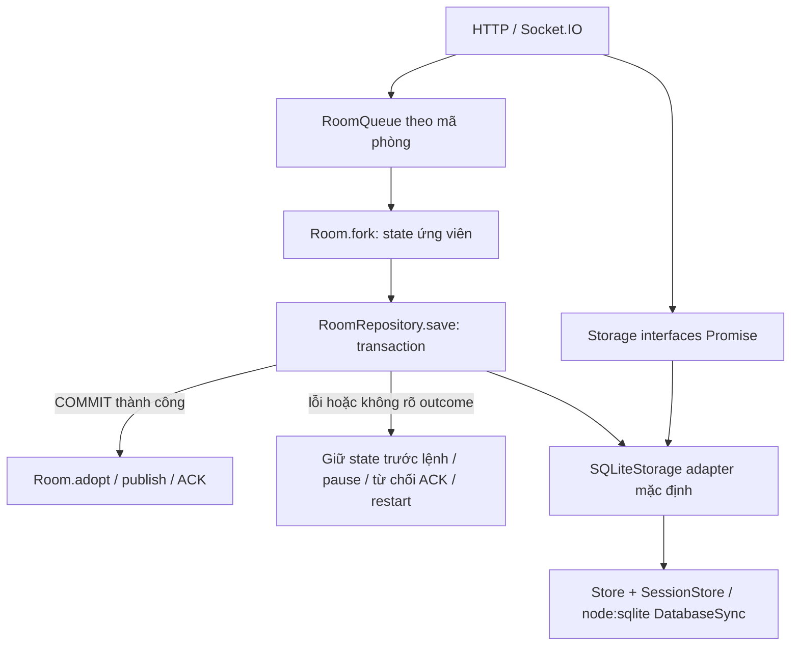

# Giai đoạn 9A — Async storage và bảo toàn multiplayer

Ngày 06/11/2026 (UTC+7). Phạm vi: abstraction Promise, SQLite adapter, queue theo phòng, transaction/ACK, checkpoint/shutdown và regression. Không kết nối Supabase hoặc deploy; không thay UI, RaceModel, schema/migration SQLite, ID/token hash, dữ liệu lớp/ảnh thật. Git hiện chưa có commit, các file đều untracked; không add/commit/publish, không xóa untracked. Bản nguồn khảo sát được lưu riêng ở `/tmp/duaxe-9a-original/` để đối chiếu; không sao chép database/ảnh riêng vào repository.

## Khảo sát trước sửa: các lời gọi đồng bộ

Đã đọc package.json, index/app/Room, Store/migrations1–2/SessionStore/API/CLI/ProcessLock, RaceModel, QuestionSession, protocol/useRoom, tests/scripts; CLASSROOM_READINESS.md và CLOUD_MIGRATION_PLAN.md. SQLite dùng node:sqlite DatabaseSync, WAL+FULL, flock; chưa có PostgreSQL driver. Các giao diện mới sẽ bọc Store mặc định, không đổi driver/schema.

| Nhóm | Vị trí hiện tại trước refactor | I/O/transaction và phụ thuộc |
|---|---|---|
| Khởi động | `Store.constructor/migrate/gc/close`, `index.ts` | Mở DB/khóa, PRAGMA/schema1–2, dọn ảnh không tham chiếu, đóng DB; giữ low-level/offline |
| Xác thực | `Store.createTeacher/login/authenticate/logout` | Scrypt, teachers/sessions SELECT/INSERT/DELETE; cookie/token SHA-256. API và Socket create/recover/release gọi authenticate trực tiếp |
| Lớp | `Store.ownClass/classes/saveClass/deleteClass` | SELECT/INSERT/UPDATE/DELETE classes, owner check; delete cascade hồ sơ rồi gc ảnh |
| Học sinh | `Store.students/student/saveStudent/deleteStudent/exportClass/profiles` | Tenant check JOIN classes, CRUD student, snapshot roster; profiles đọc file ảnh Base64 |
| Avatar | `Store.avatar/upload/removeAvatar/gc` | File read/write/rename/unlink; Sharp async decode; upload transaction INSERT avatars + UPDATE students trước GC |
| Nhập danh sách | `classroom/api.ts` import handler | BEGIN/loop saveStudent/COMMIT/ROLLBACK nằm trực tiếp trong HTTP handler; parseRoster CSV/XLSX riêng |
| Lưu phòng/đáp án | `SessionStore.save` | Một BEGIN: upsert race_sessions/checkpoint/report, xóa player không còn, upsert race_players/digest/state, insert race_answers UNIQUE rồi COMMIT |
| Checkpoint/lệnh | `app.ts saveRoom`, request/disconnect/ticker/cleanup/close | Gọi save đồng bộ; RAM mutate trước save, receipt có trong checkpoint cùng answer; timer khoảng1 Hz |
| Khôi phục | `SessionStore.load` | SELECT active tối đa50, parse/Room.restore, avatar read, save phòng đã pause; lỗi đang gộp parse và storage vào corrupt |
| Kết quả | `SessionStore.list/report/delete/expire` và API history DELETE `.db.prepare` | Owner/date/status queries; API gọi callback xóa RAM trước DELETE để tránh checkpoint tái tạo |
| Backup/restore CLI | `classroom/cli.ts` | DatabaseSync readOnly integrity/FK, VACUUM INTO, cookie removal từ bản backup, hash/copy ảnh/manifest; offline, giữ nguyên |
| Tests/benchmarks | `tests/*.test.ts`, browser/network/persistence scripts | Fixture setup và kiểm DB trực tiếp bằng Store/SessionStore; không phải đường production request, giữ tương thích low-level |

Sau refactor, SQL vẫn chỉ nằm trong SQLite implementation/Store/SessionStore/CLI; HTTP và Socket handlers dùng interface async. Câu hỏi/chấm đáp án không có SQL riêng: bộ đề, câu/quiz/receipt được commit như một aggregate phòng, không tách AnswerRepository độc lập làm mất atomicity.

## Baseline

Trước sửa: `npm test` đạt36/36 (khoảng5,51 giây), baseline network được chạy trên SQLite cũ và lưu riêng `benchmarks/async-storage/network-before.json`. Sau sửa:57/57 (khoảng6,86 giây), gồm toàn bộ36 test cũ và21 test mới. Các phép đo chỉ là mô phỏng/cloud Chromium, không phải20 điện thoại thật. Không tự bước sang9B.

## Kiến trúc sau refactor



`server/storage/contracts.ts` gồm TeacherRepository, ClassroomRepository, AvatarRepository, RoomRepository và Storage.close. Toàn bộ I/O public của abstraction trả Promise. RoomRecord là aggregate chứa checkpoint version1 và report: quiz/results, boost/slow, car/obstacle state, credential digest và receipts cùng ranh giới commit. Không tách một AnswerRepository ghi riêng, vì sẽ cho phép trả lời đã ghi nhưng receipt/boost chưa commit. QuestionSession tiếp tục xử lý câu hỏi thuần trong RAM, bộ đề đi cùng snapshot hiện có; chưa tạo bảng bộ đề hoặc migration mới.

`SQLiteStorage` bọc Store/SessionStore hiện hữu. HTTP API dùng teachers/classrooms/avatars/rooms interface, không truy cập `.db`. Socket handler chỉ gọi repository, không có SQL. Tham số `createGameServer({store})` còn là bridge tương thích test/tool cũ, tạo SQLiteStorage; `createGameServer({storage})` là đường inject adapter cho9B. Không được truyền cả hai. Chế độ không Store hoặc persistence=false của test/benchmark cũ vẫn hoạt động như trước.

Store, ProcessLock, SQL migration1–2, CLI backup/restore và driver không đổi. Các hàm sync thấp tầng/CLI/test fixtures được giữ để tương thích; **không có tuyên bố mọi dòng DatabaseSync trong repository đã biến thành nonblocking**. Không mở database thật để chạy migration/dọn ảnh trong phiên này.

## Luồng thao tác phòng và transaction

1. Kiểm input/rate limit/capability như cũ. Các entry request của một socket có reservation trong lúc đang join/create/resume, tránh một socket nhận hai membership khi đang await. Đây không phải queue per-socket.
2. Auth/profile I/O chuẩn bị ở ngoài lock; thao tác giáo viên cần cookie được kiểm lại sau khi vào queue để không dùng quyền đã bị logout trong thời gian chờ. Những lần đọc auth cần thiết cho quyền mới được giữ trong room operation; không chờ upload ảnh, HTTP ngoài hoặc gửi phản hồi mạng tùy ý trong lock.
3. Queue theo code đọc lại membership/owner.socketId, expired/status/role và receipt ở state đã commit. Cùng commandId khác payload bị từ chối. Cùng commandId đã commit trả lại kết quả cũ, không chạy boost lần nữa.
4. `Room.fork()` tạo state ứng viên có cùng prototype, status/elapsed/sequence/socket IDs/claims; sao chép car/obstacle/result/receipt/digest có thể thay đổi. Bộ đề và chuỗi avatar immutable được chia sẻ, configure luôn thay set/session mới. Không dùng Room.restore để clone vì restore cố ý pause và tăng sequence.
5. Tick catch-up/chấm đáp án/thưởng/chuyển làn/chỉnh cấu hình thực hiện trên candidate. Bản Room đang publish không thấy điểm/boost của lệnh đang chờ DB.
6. Tăng checkpoint.sequence, deep-snapshot RoomRecord trước await. SQLiteStorage gọi SessionStore.saveRecord ordered: BEGIN IMMEDIATE → kiểm sequence trong DB → upsert session/checkpoint/report → player state/digest → answers UNIQUE → COMMIT. Receipt vẫn nằm trong checkpoint/players JSON cùng transaction; không thêm bảng hoặc thay dạng dữ liệu. Reject nếu sequence bằng hoặc thấp hơn bản đã lưu.
7. Sau commit, `Room.adopt` thay state của Room đang sống, giữ identity đối tượng Room cho các observer; cập nhật đồng hồ và publish. ACK thành công chỉ gửi sau commit. Publish trạng thái đã commit có thể tới client trước ACK; đó không phải publish state chưa ghi. Network side effects thay tab/release/avatars chạy sau queue operation, giữ protocol cũ.
8. Thất bại ghi: không adopt candidate, không ACK thành công hoặc trả receipt chưa commit; khóa lệnh phòng và pause. Giữ lỗi client chung, không đưa SQL/path/record/token vào log. Adapter giả lập “commit xong nhưng phản hồi bị lỗi” cũng fail closed; khi restart load DB/receipt, replay không thưởng lại. Không tự retry một COMMIT có outcome chưa rõ rồi cấp boost lần hai.

Không hứa ACK sẽ tới thiết bị khi mạng mất: có thể DB đã commit nhưng ACK mất. Nếu còn credentials cũ, resume/retry lấy lại kết quả đã lưu. Mất ACK đầu tiên của join trước khi browser nhận token vẫn là trường hợp cần cô xử lý hồ sơ; không tạo player mới tự động để che việc mất token.

SQLite UNIQUE answer(roomCode,playerId,questionId) còn nguyên. Receipt retention vẫn **128/owner** như baseline; receipt đã ACK còn trong cửa sổ được lưu/khôi phục cùng state. Receipt quá cũ có thể bị evict theo chính sách cũ; answer/quiz độc lập vẫn ngăn thưởng trùng cho cùng câu. Không lưu toàn bộ receipt vô hạn hoặc thay schema âm thầm trong9A.

Import roster HTTP cũng chuyển vào transaction adapter. Dòng input không hợp lệ vẫn được báo lỗi riêng như cũ, nhưng lỗi DB thực phải rollback toàn bộ batch, không bị nuốt thành “dòng lỗi” rồi trả success một phần.

## Queue, clock và cleanup

- `RoomQueue` Map theo code; `$create` là admission queue nhỏ riêng cho việc cấp mã/giới hạn tổng phòng, không gom mọi gameplay vào một queue toàn server. Hai phòng có thể tiến hành độc lập khi adapter đang await. SQLiteSync bản thân vẫn chặn event loop khi thực thi SQL.
- Mỗi key tối đa128 thao tác gồm đang chạy, tổng4096; vượt ngưỡng trả lỗi/backpressure. Hàng đợi không giữ lịch sử Room/closure sau khi pending=0; entry tự gỡ kể cả khi thao tác ném lỗi. Mẫu wait giới hạn2048; thống kê aggregate không log tên, ID trẻ, payload hoặc token.
- Promise tail luôn hấp thụ lỗi cho job kế tiếp; validation error không làm hỏng queue. AsyncLocalStorage chặn acquire lồng A→A hoặc A→B→A. Không gọi một public queue operation từ bên trong chính queue đó rồi await.
- Sự kiện request/disconnect đi qua `queue.external` để không kế thừa async context của một socket write/close trước đó. Một lượt telemetry phát hiện hai disconnect bị hiểu nhầm là acquire lồng; đã sửa boundary và thêm test riêng. Hàm external chỉ dùng ở transport boundary, không phải cách bypass reentrancy trong business code.
- Timer100 ms chỉ enqueue tick khi room không bận, không tích lũy hàng trăm checkpoint cũ. Pending command/commit giữ riêng room đó; các tick bị bỏ qua được catch-up theo wall time khi xử lý tiếp, vẫn giữ clamp250 ms/advance và substep50 ms như cũ. Khi adapter rất chậm, simulation có thể chậm hơn thời gian thật; không giả tăng tốc để bù một cách sai luật.
- Checkpoint mục tiêu1 Hz, coalesce; lưu lệnh làm mới lastSaved. Timeout quiz và thay đổi trạng thái kết thúc được lưu trước publish. Tick bình thường không ghi DB mỗi frame. Sequence guard ở transaction từ chối snapshot cũ/bằng phiên bản dù bị gọi ngoài thứ tự.
- Expiry/history delete/disconnect cùng room queue, kiểm lại state sau await. Xóa lịch sử chỉ quên RAM sau DB delete thành công; không có checkpoint đang chờ tạo lại kết quả. Forget gỡ lastTick/lastSaved; queue tail gỡ entry. Roster/lớp/ảnh không bị xóa khi dọn phòng.

In-process queue không thay DB transaction hoặc distributed lock. SQLite vẫn một writer nhờ flock trên filesystem local. PostgreSQL multi-instance cần CAS/revision/lease hoặc advisory lock và fencing riêng ở9B; chưa được triển khai.

## Startup, restart và shutdown

`createGameServer` vẫn trả facade đồng bộ để tương thích caller, nhưng có `ready:Promise<void>`. Entrypoint chờ ready rồi listen; middleware Socket.IO chờ ready. GET /health trả503 khi startup chưa xong, storage fault hoặc đang đóng; không trả200 chỉ vì process còn sống.

Load async tách rõ lỗi parse/Room.restore khỏi lỗi repository. Record hỏng bị markCorrupt; lỗi đọc/ghi I/O làm startup thất bại, không đánh dấu hàng loạt phòng corrupt. Avatar thiếu/không còn quyền dùng placeholder theo luật cũ. Phòng running → paused, ready giữ ready; xóa socket online cũ, giữ ID/claims/quiz/boost và token digest. Giáo viên xác nhận tiếp tục. Room.restore vẫn tăng sequence1000 theo cơ chế cũ, checkpoint schema vẫn version1/user_version2.

Shutdown:

1. Đặt closing, dừng admission/timer, từ chối request mới; lệnh đã nhận tiếp tục drain.
2. Chờ request HTTP/Socket đang xử lý và queue; checkpoint cuối theo từng phòng.
3. Engine.IO `connection.close()` drain packet buffer trước khi Socket.IO server bị đóng. Không chỉ dùng `io.close()` ngay: test mới phát hiện điều đó có thể mất ACK vừa ghi.
4. Caller mới đóng Storage sau khi `server.close()` thành công; index.ts làm đúng thứ tự, giữ script/test cũ có ownership Store riêng. `server.idle()` dành cho test/quan sát queue; `server.drained()` chờ toàn bộ shutdown work khi đã gọi close.
5. Deadline mặc định5 giây (test có thể inject ngắn). Hết hạn ngắt transport, không phát ACK muộn và không đóng DB còn bận; entrypoint exit1, supervisor có thể restart. Khi adapter trả về muộn trong test, work vẫn drain để có thể đóng Store an toàn. Không coi reject deadline là rollback một transaction có thể đã commit.
6. SQLite đồng bộ/event loop bị treo có thể trì hoãn cả timer deadline; đây không phải hard wall-clock timeout. Cần supervisor/OS cho giới hạn cứng.
7. SIGKILL không chạy cleanup. Kernel giải phóng flock, SQLite phục hồi WAL; tải checkpoint về paused. Câu trả lời đã ACK giữ, phần quãng đường chưa checkpoint có thể lùi; không chạy bù thời gian server tắt.

## Phần sẵn sàng và phần chưa sẵn sàng cho PostgreSQL

Sẵn sàng về ranh giới code: REST và Socket handlers await interfaces; lớp/game không SQL; save aggregate atomic contract; candidate state; room serialization/backpressure; startup readiness, drain ownership và injection fake adapter có độ trễ/lỗi cho test.

Chưa có: PostgreSQL adapter/driver/migration SQL, Supabase Auth/RLS/Storage, credential mapping/importer, pool/timeout/outcome reconciliation tự động, cross-instance writer fencing, TTL cleanup DB cloud, hoặc deployment. Cookie SameSite=Strict, ảnh local, backup offline SQLite vẫn như trước. Không tự chuyển sang9B. Cần thực hiện9B theo CLOUD_MIGRATION_PLAN.md và kiểm thử Postgres/Supabase thực, không lấy SQLite mocks làm bằng chứng RLS.

## File đã sửa/tạo

| File | Nội dung |
|---|---|
| `server/storage/contracts.ts` (mới) | Interfaces Promise, RoomRecord/HistoryEntry và StaleCheckpointError |
| `server/storage/SQLiteStorage.ts` (mới) | Adapter nhóm teacher/classroom/avatar/room, transaction import, history và read active |
| `server/runtime/RoomQueue.ts` (mới) | Queue theo key, external context boundary, reentrancy/backpressure, drain/metrics |
| `server/app.ts` | Async handlers, ready, candidate commit/adopt, queue tick/checkpoint/disconnect/delete, health, shutdown/drain |
| `server/index.ts` | Dùng Storage, chờ startup, xử lý SIGTERM/SIGINT đúng thứ tự server→DB |
| `server/Room.ts` | Thêm fork/adopt, giữ luật/serializer/restore hiện có |
| `server/classroom/api.ts` | Await repositories, bỏ SQL/transaction trực tiếp |
| `server/sessions/SessionStore.ts` | saveRecord cho aggregate và kiểm sequence trong transaction; giữ helper sync tương thích |
| `tests/room-queue.test.ts` (mới) |4 test thứ tự/độc lập, lỗi/lồng/cyclic, bounds/cleanup, external async context |
| `tests/async-storage.test.ts` (mới) |5 test contract/IDs/auth/avatar/schema, stale snapshot, rollback answer/receipt, batch import và fork |
| `tests/async-server.test.ts` (mới) |12 test commit bị chậm/lỗi/unknown outcome,20 clients, tab/reconnect/auth revoke, checkpoint/expiry/shutdown/startup |
| `tests/server.test.ts`, `tests/sessions.test.ts` | Giữ assertion cũ; await cleanup và startup ready vì public maintenance/load đã async |
| `scripts/readiness-network.ts` | Đo queue, kiểm không reject nhầm/stale socket, output path riêng qua ASYNC_BENCHMARK_OUTPUT |
| `scripts/persistence-smoke.ts` | Cho chọn STOP_SIGNAL=SIGINT; vẫn SIGTERM mặc định, CRASH=1 dùng SIGKILL |
| `.gitignore` | Bổ sung .env.* trừ .env.example và các đuôi DB/guard phổ biến |
| `ASYNC_STORAGE_MIGRATION.md` (mới) | Báo cáo này |
| `benchmarks/async-storage/` (mới) | JSON baseline/after/crash/regression/source-check, ảnh giả Chromium riêng |

Đối chiếu SHA-256 nguồn trước/sau: toàn bộ `src/`, `shared/`, RaceModel/config/perspective, UI và `server/classroom/Store.ts` (gồm migration/schema) **giữ nguyên bytes**. Package.json/lockfile, ProcessLock, CLI và ảnh riêng không sửa. `source-check.json` lưu kết quả. Build tái tạo dist/dist-server/tsbuildinfo như bình thường; không stage/commit.

## Kết quả kiểm thử bản cuối

| Lệnh/nhóm | Kết quả |
|---|---|
| `npm run typecheck` | Đạt |
| `npm test` | **57/57 đạt**,0 fail/skip; baseline36 giữ nguyên assertion nghiệp vụ |
| `npm run build` | Đạt frontend Vite, backend và CLI esbuild |
| `npm run test:crash` | Đạt compiled server SIGKILL,20 phiên/20 ACK, tự lấy khóa, paused, replay không thưởng trùng |
| `STOP_SIGNAL=SIGTERM npm run test:persistence` | Đạt restart + backup/verify/restore, giữ class/student/avatar/session/points/question/credentials |
| `STOP_SIGNAL=SIGINT npm run test:persistence` | Đạt cùng bộ kiểm tra, shutdown sạch |
| `npm run test:readiness-browser` | Đạt Chromium login/classes/crop/import/20 avatar/QR/reward/lane/camera/restart/offline22 giây/history/solo; không pageerror; mobile không Phaser |
| Mô phỏng20 client + RTT/queue | Đạt, mỗi người3 đáp án,200 lệnh làn,3 ngắt transport có chủ đích/resume; không mất người/đáp án |
| Delayed/fault injection | Hai phòng độc lập; cùng phòng tuần tự; state/boost không lộ trước commit; same/different commandId chống lặp; commit-response-lost/restart lấy receipt |
| Lifecycle/cleanup | Queue lỗi vẫn chạy tiếp; chặn nested/cyclic; bounded samples; tick coalesce; expiry không mất answer và gỡ queue; deadline không đóng DB bận |

Test SQLite dùng transaction thật và trigger/query_only để gây lỗi; test delay/unknown response dùng wrapper quanh adapter thật. Đây chưa phải Postgres/network fault thật. Các test bổ sung còn kiểm logout trong lúc chờ queue, tab mới thay thế tab cũ đang trả lời và mất Wi-Fi trong lúc commit; không giảm assertion cũ để làm test qua.

Lượt SIGKILL cuối: **20 phiên, 20 đáp án đã ACK giữ nguyên, phục hồi paused**, không xóa khóa thủ công. Quãng đường lùi quan sát **29.88 m**. Đây là rollback vật lý giữa các checkpoint; không phải mất điểm/answer/receipt đã commit, và không phải cam kết tối đa cho mọi loại crash. Compiled CLI restore kiểm integrity_check=ok, foreign_key_check rỗng và giữ20 hồ sơ/ảnh giả.

## RTT, queue và FPS đo được

Nguồn: `network-before.json`, `network-after.json`, `readiness-browser.json`, `crash.json` trong thư mục bằng chứng. Linux cloud/Node24.22.1, loopback, server và20 Socket.IOclient cùng một process, SQLiteFULL; Chromium/Vitedev riêng. Không chạy build hoặc các test khác song song trong cửa sổ đo cuối.

| Chỉ số | Trước9A | Sau9A bản cuối | Mẫu |
|---|---:|---:|---:|
| RTT đáp án median | 33.59 ms | 68.43 ms |60 |
| RTT đáp án P95 | 34.26 ms | 71.83 ms |60 |
| RTT đáp án P99 | 34.36 ms | 72.00 ms |60 |
| RTT chuyển làn median/P95/P99 | 33.87/76.10/76.13 ms | 66.90/69.06/69.40 ms |200 |
| Khoảng cách frame hạng median/P95/P99 | 99.91/102.96/134.46 ms | 100.11/121.40/136.49 ms |48 sau |
| Loạt20 đáp án→frame cô có đủ kết quả | 89.21 ms | 136.49 ms |1 loạt đầu |

RTT tăng trong lượt cuối; không coi Promise wrapper là tối ưu hiệu năng. Candidate/deep snapshot, ordered-save và Promise scheduling có thêm chi phí; SQLite/scrypt/fileIO vẫn chặn event loop. Chưa tách riêng từng nguyên nhân hoặc có đủ lặp để quy toàn bộ chênh lệch. Cần đo query/clone/GC với bộ đề lớn ở9B trước khi quyết định tối ưu. P99 với60 mẫu gần giá trị tối đa, không phải SLA.

Queue sau: pending=0, activeRooms=0, maxDepth=2, completed=372, failed=0, rejected=0. 372 mẫu wait: median0.0060 ms, P950.0247 ms, P990.1141 ms. Wait là thời gian sau enqueue, **không gồm thời gian packet chờ event loop SQLite đang block**, nên không thể dùng số wait nhỏ để nói RTT thấp. Async-delay tests chứng minh room contention/independence; không đại diện latency PostgreSQL.

3 disconnect chủ động, 0 ngoài kế hoạch trong mẫu khoảng4.58 giây. Reconnect median115.29 ms/P95119.67 ms, chỉ3 mẫu với script delay100 ms; ứng dụng thật dùng backoff từ700 ms. Payload gửi tổng khoảng1331860 byte/s, nhận3764 byte/s, không gồm TCP/TLS framing và không phải mỗi máy. Snapshot đầy đủ vẫn tốn băng thông.

Lượt Chromium cuối: RAF **42.04 FPS**, P95 frame33.40 ms, heap trước/sau/GC27.51/18.33/14.02 MiB. RTT19 bot median149.14/P95150.11 ms;74 texture tổng/20 avatar. Trước9A chỉ có lượt UI lịch sử42,66 FPS trong GAME_UI_UPDATE.md, không đo baseline Chromium mới cùng phiên; không dùng hai số này làm thí nghiệm đối chứng hoặc kết luận FPS cải thiện. Chưa đạt55–60 FPS ổn định trên cloud, chưa kiểm20 điện thoại thật hoặc soak dài.

Bản đo trung gian `network-after-before-event-boundary-fix.json` có2 rejected do kế thừa async context; được giữ để chẩn đoán, không dùng số của bản lỗi làm kết quả cuối. Bản cuối kiểm rejected=0 và player.socketId trỏ socket đang sống. `regression.json` ghi exitCode0 cho ba tín hiệu và Chromium. Các benchmark/screenshot giai đoạn7/UI cũ đã được sao lưu và khôi phục nguyên dữ liệu; ảnh mới chỉ chứa dữ liệu giả trong thư mục async-storage.

## Chạy lại và giới hạn còn tồn tại

```sh
npm run typecheck
npm test
npm run build
ASYNC_BENCHMARK_OUTPUT=benchmarks/async-storage/network-current.json npm run benchmark:readiness-network
npm run test:crash
STOP_SIGNAL=SIGTERM npm run test:persistence
STOP_SIGNAL=SIGINT npm run test:persistence
npm run test:readiness-browser
```

Các script crash/browser mặc định ghi benchmark lịch sử ở root benchmarks; khi chạy lại hãy bảo toàn hoặc chuyển kết quả riêng như phiên này. Bằng chứng mới: [network](benchmarks/async-storage/network-after.json), [crash](benchmarks/async-storage/crash.json), [Chromium](benchmarks/async-storage/readiness-browser.json), [avatar20 xe](benchmarks/async-storage/classroom-start.png), [màn học sinh](benchmarks/async-storage/classroom-phone.png).

- Promise adapter không làm DatabaseSync/scrypt/fileIO chạy trên worker; event loop có thể nghẽn, queue khác không đồng nghĩa SQL chạy song song. Không đổi driver ở9A.
- Per-room ordering/candidate có thêm CPU/RAM; snapshot bộ đề tới8 MB được clone/ghi lại theo cơ chế cũ. Chưa benchmark bộ đề tối đa hoặc50 phòng đồng thời;9B cần normalize nội dung bất biến, đo write amplification nhưng không đổi luật.
- Storage error cố ý fail closed toàn bộ gameplay dùng cùng storage, health503; queue không bị poison nhưng service vẫn khóa tới restart. Chưa tự động reconcile/reopen kết nối sau unknown COMMIT.
- Một storage call không bao giờ resolve có thể giữ room queue; đã có giới hạn pending và shutdown deadline nhưng chưa có per-query cancellation/timeout ở adapter đồng bộ. Deadline JS không cắt được một syscall SQLite đang block; cần supervisor.
- SQL stale guard dựa sequence checkpoint cũ và transaction; distributed writer fencing/lease chưa có. Không dùng queue này để scale nhiều Render worker.
- Receipt retention128/owner và tăng sequence1000 khi restore còn như baseline; không cung cấp archive receipt vô hạn hoặc epoch protocol mới. SQLitecheckpoint1 Hz vẫn có rollback quãng đường/boost chưa kèm lệnh.
- Auth cookie12 giờ/quick anonymous room/preview avatar theo mã phòng còn như baseline; SupabaseAuth/RLS/privateStorage và việc siết quyền preview là9B, chưa được thực hiện. Không kết luận đã an toàn cloud vì57 test SQLite qua.
- Chưa test20 điện thoại thật/Wi-Fi thực, Supabase, Render restart hoặc WSS public. Chưa công bố sẵn sàng lớp học thật.
