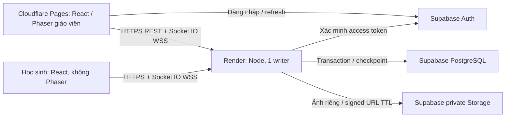

# Giai đoạn 9 — Kế hoạch chuyển Cloudflare Pages + Render + Supabase

> Cập nhật 06/11/2026: triển khai production theo quyết định **không tạo staging riêng**. Xem [PRODUCTION_READINESS_PLAN.md](PRODUCTION_READINESS_PLAN.md) và [PRODUCTION_IMPLEMENTATION.md](PRODUCTION_IMPLEMENTATION.md). Các phần khảo sát/staging dưới đây là lịch sử; không dùng để tự publish hoặc thay target của công cụ cũ.

Ngày khảo sát: 06/11/2026, UTC+7. Trạng thái: **thiết kế từ mã nguồn hiện có; chưa triển khai adapter, SQL PostgreSQL, công cụ import hoặc dịch vụ cloud**. Phiên này chỉ thêm tài liệu, kiểm thử baseline; không mở Store trên dữ liệu thật, không đổi SQLite/ảnh, không migration production. Hướng dẫn vận hành: [DEPLOY_CLOUDFLARE_RENDER_SUPABASE.md](DEPLOY_CLOUDFLARE_RENDER_SUPABASE.md).

## 1. Bằng chứng khảo sát

- Đã thực thi `pwd`, `ls -la`, `git status --short`, `git ls-files`; repository `/workspace/duaxe` truy cập được. Nhánh `work` chưa có commit, `git ls-files` rỗng, mã nguồn hiện là untracked. `git log -1` báo chưa có commit; đây là trạng thái Git, không phải lỗi mất mã. Không init lại Git, add/commit/push/publish.
- Node v24.22.1, npm 11.9.0; đã có node_modules, `/usr/bin/flock`, `/usr/bin/chromium`. Không tìm thấy AGENTS.md trong workspace qua tìm kiếm file.
- Đã đọc package.json, cấu hình Vite/TS, frontend classroom/online/game/questions, backend Store/API/SessionStore/Room/app/index/CLI/ProcessLock, giao thức shared; đối chiếu CLASSROOM_READINESS.md, CLASSROOMS.md, PERFORMANCE_AND_SESSIONS.md và các test/scripts liên quan.
- Dependencies hiện không có Supabase SDK hoặc driver PostgreSQL; chưa có thư mục SQL migrations PostgreSQL, Render blueprint hoặc cấu hình Cloudflare triển khai. Không suy diễn các tính năng này đã tồn tại.
- Metadata môi trường hiện không khai báo secret, runtime variable hay outbound identity cho ba dịch vụ. Chưa kiểm tra tài khoản/dự án cloud từ xa, chưa xác nhận quyền staging. Không đọc nội dung secret hoặc database thật để khảo sát.

| Phần hiện tại | File thực tế | Ý nghĩa khi chuyển cloud |
|---|---|---|
| Entry React, lazy-load | `src/main.tsx`, `src/SoloApp.tsx`, `src/online/OnlineApp.tsx` | Giữ mode qua query; teacher lazy-load RemoteTrack; học sinh không tải Phaser |
| Render/nội suy | `src/game/RaceScene.ts`, `src/game/perspective.ts`, `src/online/SnapshotBuffer.ts`, `RemoteTrack.tsx` | Giữ 3 làn, camera, nhãn/avatar theo ID, buffer 150 ms; không tự tính kết quả ở client |
| Mô phỏng/chấm đáp án | `src/game/RaceModel.ts`, `config.ts`, `src/questions/model.ts`, `server/Room.ts` | Giữ nguyên luật; mỗi người online có RaceModel(true), tối đa 20 qua LIMITS |
| Network | `server/app.ts`, `shared/protocol.ts`, `src/online/useRoom.ts` | Request schema, capability, commandId, frame/question sequence, tab replacement giữ nguyên hành vi |
| Dữ liệu lớp/ảnh/auth | `server/classroom/Store.ts`, `api.ts`, `src/classroom/api.ts` | SQLite đồng bộ, cookie 12 giờ, ảnh local; cần repository async/Auth/Storage adapter |
| Persistence/lịch sử | `server/sessions/SessionStore.ts`, `src/classroom/GameHistory.tsx` | Transaction trước ACK, checkpoint khoảng 1 Hz; list/filter/report/delete/recoverTeacher |
| Backup/khóa | `server/classroom/cli.ts`, `ProcessLock.ts` | flock/.guard chỉ cho nhánh SQLite; backup offline + checksum + integrity/FK checks |
| Build/server | `package.json`, `server/index.ts`, `vite.config.ts` | build = tsc + Vite + esbuild server/CLI; Node PORT/0.0.0.0 đã có |

API frontend **đã dùng** VITE_SERVER_URL cho REST và Socket.IO. Vite proxy chỉ hoạt động khi chạy dev, không có proxy ở build static. Auth hiện là cookie HttpOnly/SameSite=Strict (Secure khi production); thêm CORS không giải quyết cookie cross-site. API preflight hiện chưa cho phép Authorization. `avatarUrl()` hiện dùng `` URL không có Bearer header. Đây là các thay đổi bắt buộc, không chỉ thay biến môi trường.

## 2. Toàn bộ migration SQLite hiện có

Migration nằm trong `ClassroomStore.migrate()`, không có các file .sql riêng. Khởi tạo mới chạy 0 → 1 rồi 1 → 2; user_version >2 bị từ chối. Đây là schema trong mã, không phải tuyên bố đã đọc user_version của DB thật.

| Phiên bản | Bảng, ràng buộc chính |
|---|---|
| 0 → 1 | `teachers(id,email UNIQUE,password,createdAt)`; `sessions(tokenHash PK,teacherId FK CASCADE,expiresAt)`; `classes(id,ownerId FK,name,schoolYear,createdAt,updatedAt)`; `avatars(id,ownerId FK,storageKey UNIQUE,mimeType,fileSize,createdAt)`; `students(id,classId FK CASCADE,fullName,displayName,avatarId FK SET NULL,status active/inactive,createdAt,updatedAt)`; index students_class/classes_owner |
| 1 → 2 | `race_sessions(code PK,ownerId FK,classId,status,createdAt,startedAt,finishedAt,updatedAt,checkpoint,report,error)` + owner/date index; `race_players(roomCode FK CASCADE,playerId,studentId,digest,state)`, PK(roomCode,playerId), UNIQUE(roomCode,studentId); `race_answers(roomCode,playerId,questionId,result)`, PK(roomCode,playerId,questionId), composite FK CASCADE |

SQLite dùng WAL, synchronous=FULL, foreign_keys=ON, busy_timeout=5000. `classId` trong race_sessions và `studentId` trong race_players không có FK tới hồ sơ sống: lịch sử có thể tồn tại khi lớp/học sinh đã xóa. Không tự thêm FK buộc import tạo lại hồ sơ đã xóa.

Bộ câu hỏi đang nằm trong checkpoint JSON `set`, version=1, gồm 1–100 câu, ID text ≤100 ký tự (ví dụ `sun`, không phải UUID), mỗi câu 2–4 option ID text, timeLimit 5–120 giây, đúng một correctOptionId; ảnh câu hỏi data URI giới hạn 2 MB; bộ đề online ≤8 MB. Chưa có kho bộ đề SQL độc lập.

Checkpoint Room version=1 gồm băm capability giáo viên/học sinh, tối đa 128 receipt/owner, snapshot roster không chứa ảnh, trạng thái race/quiz, obstacle hit, boost/slow, elapsed/sequence. `report` có đáp án và tên snapshot, không ảnh/token. SessionStore lưu các bảng phòng/người/đáp án trong một transaction trước ACK; checkpoint vật lý khoảng một giây. Physics có thể lùi về checkpoint khi crash; không có giới hạn một giây cứng khi IO/event loop nghẽn.

## 3. Kiến trúc đích và phạm vi bất biến

Render tiếp tục authoritative, không dùng Supabase Realtime thay Socket.IO. Giữ RaceModel/config/perspective/thuật toán hạng: 3 làn, đường 3200 m, boost 3 giây, slowdown/vật cản, điểm 10/câu đúng như Room.frame; không sửa tốc độ/hạng để giãn xe. Giữ pause/resume, chống lặp, reconnect, online/offline, nội suy và solo.

Tách interface `ClassroomRepository`, `SessionRepository`, `AvatarStore`, `TeacherAuthenticator` dạng Promise; giữ adapter SQLite cho local/regression. Không kế thừa Store rồi giả đồng bộ cho request qua mạng. `createGameServer` sẽ phải khởi tạo async, load/reconcile phòng xong mới ready; API không truy cập `.db` trực tiếp. PostgreSQL chọn driver `pg` (thêm types) để transaction nhiều câu lệnh trên cùng connection; Supabase SDK cho Auth/Storage, không gọi nhiều REST upsert rồi coi là một transaction.

## 4. Schema PostgreSQL đề xuất (chưa có migration thực thi)

Quy ước snake_case trong SQL, mapper trả camelCase như protocol cũ. Giữ tất cả ID gốc; không đổi sang identity/serial. ID UUID từ hồ sơ/player phải validate, các ID câu hỏi/option là text. Thời gian UTC timestamptz; elapsed/responseTime/boost/distance là số hữu hạn theo giây/mét như hiện tại. Không round trước khi lưu hoặc đổi sort hạng.

| Bảng đề xuất | Khóa và dữ liệu |
|---|---|
| `teachers` | `id uuid PK` giữ ID SQLite; `auth_user_id uuid UNIQUE` liên kết auth.users, nullable chỉ khi tài khoản chưa được liên kết; email/created_at; không nhập password scrypt |
| `classes` | id gốc, teacher_id FK teachers, name/school_year/timestamps; index teacher/date |
| `avatars` | id gốc, teacher_id, private bucket/object_key UNIQUE, WebP/mime/size/checksum, created_at; không URL signed cố định |
| `students` | id gốc, class_id FK CASCADE, full/display_name, avatar_id FK SET NULL, status check; tenant phải cùng owner của lớp/ảnh |
| `question_sets` | id mới, teacher_id, title/version/revision, created_at; không thay ID câu trong nội dung |
| `questions`, `question_options` | PK(set_id,question_id), PK(set_id,question_id,option_id); position unique theo cha, time_limit check, text/image reference, correct_option_id FK composite (deferred nếu cần); validate 2–4 option tại transaction/backend |
| `race_sessions` | code text PK giữ 6 ký tự; owner_id nullable cho phòng anonymous cũ; class_id_snapshot (không FK bắt buộc), status, timestamps, checkpoint_version, checkpoint jsonb, report jsonb, revision bigint, recovery_epoch bigint, writer_epoch bigint, error; index owner/date/status |
| `room_roster` | PK(room_code,student_id_snapshot); tên/avatar ID snapshot, live_student_id nullable FK SET NULL; không bắt buộc nguồn còn tồn tại |
| `room_questions` | PK(room_code,question_id); position, nội dung/option/đáp án đúng/time_limit snapshot bất biến sau start; cách ly khỏi quyền student |
| `race_players` | PK(room_code,player_id uuid), UNIQUE(room_code,student_id_snapshot); student snapshot nullable cho quick join; digest hex/binary check, state jsonb; bảng này không public |
| `race_answers` | PK(room_code,player_id,question_id), FK player và room_question; selected_option nullable, correct, response_time, timed_out, result jsonb; chỉ backend chấm |
| `command_receipts` | PK(room_code,role,actor_id,command_id); request_hash, result jsonb, revision; không chứa token; teacher actor_id là text `teacher`, không ép UUID |
| `migration_batches`, `migration_items` | batch ID, checksum nguồn/manifest, trạng thái, ID/object đã tạo, checksum/revision đích; chỉ operator/backend |

Report jsonb chính là lịch sử snapshot hiện có; chưa cần một bản sao bảng history cạnh tranh nguồn sự thật. Hạng/điểm từ Room.report, không từ client hay SQL sửa tùy ý. `question_sets` phục vụ bộ đề lưu lâu dài mới; bộ đề import từ từng phòng tạo snapshot riêng, không gộp chỉ vì trùng questionId/title. Câu hỏi cùng ID ở hai phòng không liên quan nhau.

Các snapshot nguyên gốc có digest/receipt và correctOptionId: đặt trong schema riêng `game_private` không expose qua Data API. Đặt lớp/học sinh/metadata bộ đề ở schema có RLS. Tách API view/DTO an toàn, không cấp student SELECT vào checkpoint/report của cả phòng. Cần versioned SQL migrations trong `supabase/migrations/` ở bước triển khai sau, không chạy DDL tự động từ HTTP start.

## 5. Auth, RLS và quyền truy cập

### Giáo viên

- Frontend Supabase Auth (email/password hoặc invite/reset), chỉ tài khoản đã được liên kết teachers mới có quyền. Không mặc định mọi auth.users đều là giáo viên; tắt đăng ký tự do cho staging lớp học.
- REST gửi `Authorization: Bearer <access_token>`; Socket.IO dùng `auth.accessToken`, không token trên URL/QR. Backend dùng Supabase `auth.getUser(accessToken)` để kiểm tra với Auth service; JWT decode không đủ. Nếu sau này chuyển JWKS phải kiểm tra signature/issuer/audience/exp và chính sách thu hồi.
- Map auth subject → teachers.auth_user_id → teachers.id gốc. Không nhận teacherId từ client làm owner. Không liên kết bằng email do client tự khai; operator liên kết tài khoản đã xác minh bằng manifest.
- Giữ capability phòng riêng; với phòng có owner, mọi create/configure/control/report/release/recoverTeacher và teacher resume phải đồng thời có Auth còn hiệu lực và đúng owner. Hiện quick create có thể anonymous; ở cloud tắt tạo phòng giáo viên anonymous mới, không biến mã phòng thành quyền quản trị. Phòng anonymous legacy chỉ được phục hồi backend theo capability/TTL trong nhánh tương thích, không tự gán owner.
- Refresh token theo Supabase session; cập nhật socket auth và reconnect khi cần. Kiểm tra hết hạn trên lệnh quản trị và định kỳ: pause phòng khi quyền không còn hợp lệ, refresh/re-auth xong vẫn chờ cô resume. Logout/đổi user ngắt teacher socket cũ. Giữ cơ chế tab replacement, token rotation khi recoverTeacher.
- Không nhập cookie sessions SQLite hoặc salt:scrypt vào Supabase Auth. Dùng invite/reset hoặc tài khoản Auth đã có được operator map. Không hứa mật khẩu cũ dùng lại. Admin Auth APIs ngoài transaction SQL: journal và kiểm tra lại khi retry.

### Học sinh và RLS

Học sinh chưa có tài khoản Supabase. Không chuyển token resume thành JWT Supabase, không cấp service key cho máy học sinh. Token ngẫu nhiên 32 byte như hiện tại, SHA-256 trong DB, verify timing-safe; cần credentials hợp lệ mới resume. Không tự tạo player mới nếu còn phiên cũ. DeviceId/tên/mã phòng không phải bằng chứng sở hữu.

| Principal | Dữ liệu lớp/học sinh/bộ đề | Phòng/đáp án/checkpoint | Ảnh |
|---|---|---|---|
| Supabase `anon` | Không đọc/ghi | Không đọc/ghi trực tiếp | Bucket private; không public list/read |
| Giáo viên Auth A | RLS chỉ các bản ghi của A, kể cả WITH CHECK khi INSERT/UPDATE; không đổi owner | Chỉ DTO lịch sử thuộc A qua backend; checkpoint/receipt không expose | Backend kiểm tra owner, signed URL TTL |
| Học sinh có capability | Không truy cập Data API | Qua Socket.IO: câu hiện tại đã bỏ correctOptionId, trạng thái phòng và kết quả của mình | Chỉ ảnh thuộc roster của phòng đang hợp lệ |
| Runtime backend | Role SQL riêng, quyền tối thiểu cần để load/commit phòng; kiểm tra tenant trong API | Ghi authoritative qua transaction; client không gọi được | Service credential chỉ trên Render để ký/upload |

Policy teachers dùng trực tiếp `auth_user_id = auth.uid()`. Các bảng phụ dùng EXISTS join tới teachers/classes theo owner, cả USING và WITH CHECK. Không dùng policy self-query gây recursion. Áp RLS cho cả con/join table; chặn gán avatar/lớp của giáo viên khác bằng FK composite hoặc validation trong transaction. Column grants/view ngăn Auth A sửa auth_user_id, digest, điểm và owner_id.

Runtime SQL role không dùng postgres superuser làm tài khoản app. Nếu policy riêng cho game_runtime cho phép xử lý nhiều tenant, RLS không thay thế kiểm tra quyền backend. Service role Supabase có thể bypass RLS: chỉ dùng cho tác vụ Auth admin/Storage cần thiết, không lấy kết quả truy vấn không lọc owner trả client. RLS phải test bằng anon và hai JWT thật, không chỉ test bằng service role. Với Storage, đường dẫn owner/avatar không tự tạo quyền; bucket private, client không được upload/delete trực tiếp nếu đã chọn API trung gian.

**Khoảng trống hiện có:** preview mã phòng trả tên hiển thị và avatar Base64 trước claim. Thiết kế cloud phải giới hạn preview chưa xác thực chỉ danh sách tối thiểu/placeholder, và chỉ cấp ảnh sau claim hợp lệ hoặc giáo viên cho phép. Người biết mã vẫn có thể chiếm hồ sơ trống theo UX hiện tại; đây là rủi ro danh tính cần giải quyết/duyệt trước ảnh thật, không được gọi là RLS đã bảo vệ học sinh.

## 6. Commit async, restart và giữ luật reconnect

Chỉ thêm await vào `saveRoom` là không đủ: ticker, đáp án khác, disconnect và callback API có thể xen nhau trong khi Room đã bị mutate.

1. Tạo queue tuần tự theo phòng cho request/control/disconnect/timeout/checkpoint. Chuẩn bị một state ứng viên tách biệt, không mutate state đã công bố; không dùng `Room.restore()` để clone vì restore cố ý pause và tăng sequence.
2. Validate actor/commandId/question trên state đã commit; tính đúng/sai và boost bằng logic hiện có. DB transaction lock row phòng/revision, insert đáp án UNIQUE, receipt + cập nhật quiz/race/checkpoint/report cùng revision. Nếu đáp án đã tồn tại thì trả kết quả đã commit, không thưởng lại.
3. COMMIT thành công mới hoán đổi state trong RAM, publish kết quả và ACK. Mất ACK sau commit: retry cùng commandId lấy receipt DB. Cùng commandId khác payload bị chặn. Hết cửa sổ receipt vẫn có UNIQUE câu trả lời để không thưởng lại.
4. Khi COMMIT timeout/không rõ kết quả: không trả thành công từ RAM, pause/fail closed và đọc lại receipt/revision trên connection mới. Chỉ tiếp tục khi đã reconcile; không apply boost lần hai. Tách lỗi dữ liệu khỏi lỗi kết nối khi load để không đánh dấu mọi phòng corrupt khi Supabase lỗi mạng.
5. Physics vẫn dùng tick server; không ghi DB mỗi frame. Khi một lệnh bền vững đang chờ commit, tích lũy tick theo thứ tự với giới hạn/backpressure, không mutate state đang commit rồi ghi đè bằng candidate cũ; test clock/timeout dưới độ trễ DB là bắt buộc. Checkpoint bất biến ở nhịp mục tiêu 1 Hz, coalesce backlog, không cho checkpoint cũ ghi đè đáp án mới. Mọi câu trả lời đã ACK phải có cùng quiz/race/receipt trong transaction. Đo write amplification: snapshot có cả bộ đề tới 8 MB; lưu nội dung bất biến riêng và snapshot tham chiếu sau khi adapter đã được test, không ghi bộ đề lại 1 Hz dài hạn.
6. Shutdown ngừng nhận lệnh, drain queue có deadline, commit cuối trước đóng kết nối. Khi crash, load version/checksum/Room.restore; running → paused, ready giữ ready, socketId xóa, quiz clock không chạy bù; manual teacher resume. Giữ giới hạn 50 phòng, TTL 2 giờ/teacher vắng 10 phút/finished 15 phút như hiện tại.
7. Sequence tăng 1000 lúc restore hiện tại có thể nhỏ hơn số frame đã gửi từ checkpoint nếu DB bị treo lâu. Bổ sung recovery_epoch persist + sequence, so sánh tuple bên client hoặc cấp dải sequence monotonic được lưu trước; phải kiểm thử frame cũ sau restart, không bỏ cơ chế chống out-of-order.
8. Một instance không bảo đảm không có hai tiến trình khi rolling deploy. Dùng advisory lock PostgreSQL trên dedicated connection (không transaction-pool) hoặc lease+fencing writer_epoch kiểm tra trong mọi commit. Chưa giữ quyền writer thì không tick/ACK/ready. Mất lock/lease phải ngừng mô phỏng ngay; deploy thử có hai process để xác minh. Không dùng `.guard` local trên Render để bảo vệ database cloud.

Quãng đường chưa checkpoint vẫn có thể lùi; giữ số đo rollback và tuổi checkpoint, không cam kết bằng 0. Supabase/network outage phải hiển thị lỗi lưu trữ, không quay về RAM-only mà tiếp tục ACK.

Đổi origin frontend là một thay đổi vận hành: localStorage token học sinh ở LAN/localhost không tự chuyển sang pages.dev. Không đưa token vào QR để chuyển. Cutover giữa các buổi, giữ frontend origin ổn định sau staging; nếu cần mang phiên đang chạy sang origin mới phải thiết kế luồng chuyển có xác thực riêng. Digest trong DB không giúp browser lấy lại token rõ.

## 7. Private avatar và tính nhất quán ảnh

Giữ Sharp kiểm tra bytes thật (JPG/PNG/WebP tĩnh), ≤2 MB, ≤16 triệu pixel, xoay EXIF, resize128/WebP bỏ metadata và giới hạn 2 tác vụ xử lý song song. Không lấy file local làm nguồn bền vững Render.

Upload object key bất biến theo teacherId/avatarId; upload mới trước, DB transaction đổi student.avatar_id sau; rollback DB thì object chưa tham chiếu được journal để GC sau. Không xóa ảnh cũ trước commit; GC kiểm tra cả tham chiếu snapshot phòng và retention lịch sử. Không có transaction nguyên tử giữa Storage và SQL: bắt buộc cơ chế bù, không hứa rollback SQL xóa luôn object.

Ảnh giáo viên: fetch qua API Bearer thành blob URL (revoke khi thay/unmount) hoặc endpoint cấp signed URL ngắn hạn. Không chỉ đặt Bearer trong helper rồi giữ `` endpoint cũ. Ảnh phòng: xác thực teacher owner hoặc student capability + roster trước khi cấp URL TTL ví dụ 60–120 giây; kiểm tra phòng hết hạn/release mỗi lần cấp lại. URL đã cấp vẫn có thể dùng tới hết TTL, xóa local texture không thu hồi ngay URL đã lộ.

Giữ avatarId làm texture key, playerId/studentId làm mapping; signed URL đổi không tạo texture key mới mỗi lần. Refresh URL có kiểm soát, không mỗi frame; khi mất quyền/xóa ảnh dùng placeholder. Nếu Phaser tải URL Storage cross-origin, cấu hình/test CORS WebGL/canvas và refresh; có thể fetch blob hợp lệ rồi giữ texture cache hiện có. Không serialize URL ký/token/ảnh học sinh vào log/checkpoint/CSV/JSON report. Ảnh minh họa câu hỏi là loại khác: giai đoạn đầu giữ data URI hợp lệ khi import, sau đó mới tách bucket/path riêng có migration định dạng rõ.

## 8. Thiết kế import có kiểm tra và rollback

**Công cụ chưa tồn tại.** Đề xuất `scripts/cloud/import-sqlite.ts`, `verify-import.ts`, `rollback-import.ts` với dry-run mặc định, bắt buộc target staging/project allowlist và manifest đã duyệt khi apply. Không tạo lệnh npm giả trong hướng dẫn như thể đã chạy được.

1. Trên nguồn, dừng server sạch/đưa buổi học về pause theo kế hoạch vận hành; backup CLI offline theo CLASSROOMS.md. Không mở ClassroomStore trên DB gốc chỉ để đọc vì constructor chạy migrate/gc. Làm việc trên bản backup/copy hoàn chỉnh có WAL nhất quán, mở DatabaseSync readOnly. Tuyệt đối không copy riêng file DB đang ghi bỏ WAL, không xóa lock/WAL/SHM.
2. Validate user_version1/2, integrity/FK check, UUID/ID, tenant, status, question schema, đáp án/receipt, nội dung checkpoint qua parser và hash manifest ảnh. Với v1 cần chuẩn hóa bản sao, không sửa nguồn. Checkpoint lỗi: báo cách ly theo code/batch, giữ nguyên bytes và report hợp lệ; không tự sửa hoặc bỏ im lặng.
3. Dùng nguồn có checksum + batch ổn định; dry-run thống kê từng bảng, danh sách lỗi ID an toàn và ảnh thiếu, map teachers sang Auth có xác minh. Không log tên/email/token/password/checkpoint nguyên bản. Không import sessions cookie; giữ digest capability nếu hỗ trợ resume trên cùng origin.
4. Chuyển thời gian: ISO của lớp/học sinh sang timestamptz, milliseconds của room sang timestamptz có kiểm tra range; preserve số giây/mét. Lịch sử lớp/học sinh đã xóa dùng snapshot IDs; không cấp hồ sơ mới để vượt FK. Không đổi ID `teacher` của actor hay questionId sang UUID.
5. Upload object vào prefix batch riêng, checksum đối chiếu; record manifest trước thao tác để có thể tìm object nếu crash giữa upload và journal. Không overwrite path đã có khác checksum. Auth provisioning journal riêng; không xóa tài khoản đã có khi rollback.
6. SQL transaction insert/mapping constraints; chỉ no-op khi bản ghi trùng ID và checksum/nội dung đúng. Xung đột khác nội dung phải fail, không ON CONFLICT UPDATE mù quáng ghi đè dữ liệu đích. batch chưa verify không cho runtime load. Kích thước lớn có thể chia lô staging nhưng chỉ activate sau kiểm tra toàn bộ.
7. Verify counts/ID sets/quan hệ, ảnh checksum, số điểm/đáp án/report, room ready/paused, teacher ownership, băm token không rõ, UNIQUE claims. Sau đó activate staging, test replay/restore/20 clients. Source backup SHA-256 trước/sau phải không đổi.
8. Rollback DB chưa commit: transaction rollback. Đã commit: chỉ delete rows tạo bởi batch có revision/hash còn nguyên, theo thứ tự con→cha; nếu đã phát sinh dữ liệu mới thì dừng rollback tự động và reconcile. Xóa object được batch tạo nếu không còn tham chiếu và checksum khớp; thất bại ghi cleanup pending. Không TRUNCATE, không drop schema chung, không xóa DB/ảnh nguồn. Chỉ operator xử lý Auth account mới được tạo riêng cho batch, không tự xóa tài khoản dùng chung.

Rollback dịch vụ sau cutover khác rollback import: dữ liệu cloud mới không có trong SQLite cũ. Dừng ghi, backup cả hai, export/reconcile dữ liệu phát sinh rồi mới đổi lại; không tuyên bố chỉ đổi URL là giữ đủ kết quả.

## 9. Công việc theo thứ tự và kiểm thử chấp nhận

| Bước | Việc cần làm | Điều kiện qua bước |
|---|---|---|
| A — hiện tại | Khảo sát + hai tài liệu + baseline local | Không sửa runtime/dữ liệu; ghi rõ kết quả test |
| B | Repository async + teacher authenticator + per-room queue, giữ SQLite adapter | 36 test hiện có và test concurrent await không đổi luật/ACK |
| C | SQL versioned, RLS/grants, Storage private, Auth mapping, Pg repositories | Test trên PostgreSQL/Supabase staging thật; không coi mock là đã kiểm RLS |
| D | Import dry-run/verify/rollback, fixture v1/v2, orphan history và lỗi | ID/checksum không đổi; rollback partial Storage/Auth được kiểm |
| E | Frontend Auth, API Bearer/ảnh, Socket auth, expired/refresh, QR Pages | Chromium cross-origin HTTPS, no secret trong dist, avatar đúng 20 xe |
| F | Render single writer + readiness/drain, checkpoint/recovery_epoch | Kill trước/sau commit/mất ACK, hai instance trùng, DB outage đều không thưởng trùng |
| G | Deploy staging theo tài liệu ba dịch vụ | 20 client/WSS/restart/reconnect/history/export đạt; quan sát RTT/FPS/DB writes |
| H | Checklist 20 điện thoại thật của CLASSROOM_READINESS.md + cloud cold-start | Có người thử, thiết bị, mạng, ≥45–60 phút; mới cân nhắc triển khai thật |

Regression phải giữ thứ hạng theo quãng đường/finishTime/id như Room.frame, đáp án đúng một lần, timeout/pause theo elapsed, boost3 giây, obstacle slowdown, trùng tab và profile claim, khôi phục teacher owner. Bổ sung test cross-tenant cả SQL/REST/Storage, token hết hạn/sai issuer, role claim giả, private ảnh sau release/hết phòng; export không token/ảnh; import không thay nguồn; crash không mất đáp án đã ACK. `npm test` hiện dùng SQLite/RAM, không chứng minh PostgreSQL/RLS/Render đã đạt.

## 10. Baseline kiểm thử phiên khảo sát

Đã chạy ngày 06/11/2026 trên Node24.22.1/Linux cloud; các test dùng dữ liệu giả/thư mục tạm. Không mở nguồn SQLite thật. Các build artifact dist/dist-server/tsbuildinfo được tái tạo bởi build, không sửa mã ứng dụng.

| Kiểm tra thực thi | Kết quả |
|---|---|
| `npm run typecheck` | Đạt |
| `npm test` | **36/36 đạt**, 0 fail/skip; khoảng4,99 giây |
| `npm run build` | Đạt tsc/Vite/esbuild, client + server + CLI |
| `npm run test:crash` | Đạt: SIGKILL compiled server với20 phiên,20 đáp án đãACK giữ nguyên, paused khi restart, replay không thưởng trùng; backup/verify/restore DB/ảnh, integrity/FK đạt |
| `npm run test:readiness-browser` | Đạt Chromium:20 hồ sơ/avatar đúngID qua camera/hạng, restart, offline22 giây/resume, history xem/xuất/xóa, solo canvas, mobile không Phaser; không lỗiJS |

Cảnh báo build còn: RaceScene chunk1.500,02 kB minified /346,09 kB gzip vượt500 kB; lazy-load vẫn như cũ, chưa tối ưu bundle trong phiên tài liệu này.

Lượt SIGKILL mới đo rollback **27,83 m**, phòng paused, không xóa khóa thủ công,20 ACK giữ nguyên. Lượt Chromium mới: RAF **44,28 FPS**, P95 frame33,40 ms, RTT đáp án19 bot median64,60/P9565,20 ms, heap sauGC13,19 MiB. Đây là Vite dev/headless/loopback,1 teacher+1 mobilebrowser+19 sockets, không HTTPS/WSS Internet hay20 thiết bị thật. Không đo P99 ở lượt Chromium này. CPU Scene.update và React render là phép đo bộ phận, không đại diện cả GPU/frame.

Log và JSON của lần kiểm thử mới ở `/tmp/duaxe-stage9-checks-prgn44s2/` (tạm thời, không phải artifact đã publish). Benchmark/screenshot lịch sử trong repository đã được sao lưu và khôi phục nguyên bytes sau chạy; hai tài liệu mới là thay đổi nội dung chủ động duy nhất. Số đo giai đoạn7 trong CLASSROOM_READINESS.md vẫn là lịch sử, không bị thay bằng lượt mới.

**Chưa thử:** migration SQLite→PostgreSQL, Supabase Auth/RLS/privateStorage, Render restart/single-writer qua cloud, HTTPS/WSS cross-origin thật, Cloudflare QR public và20 điện thoại thật. Không có adapter/importer cloud để gọi những kiểm tra này thành công. Các kết quả SQLite local không chứng minh đích cloud đạt yêu cầu.

## 11. Đầu ra khảo sát và bước kế tiếp

Tạo mới đúng hai tài liệu: CLOUD_MIGRATION_PLAN.md và DEPLOY_CLOUDFLARE_RENDER_SUPABASE.md; không sửa RaceModel, Room/protocol/reconnect, package.json/lockfile, SQL SQLite hoặc ảnh nguồn. Không commit/push/publish/deploy, không thực hiện cloud migration.

Ưu tiên tiếp theo là bướcB: interface async + queue + test fault/concurrency trong nhánh SQLite trước, rồi SQL/RLS và adapters cloud ở staging. Rủi ro cần đóng: commit async xen nhau, split writer trong rolling deploy, timeout commit không rõ kết quả, cookie cross-site, mất token khi đổi origin, quyền preview/avatar trước claim, snapshot orphan và transaction không bao phủ Auth/Storage. Chưa có căn cứ công bố sẵn sàng lớp học thật.
